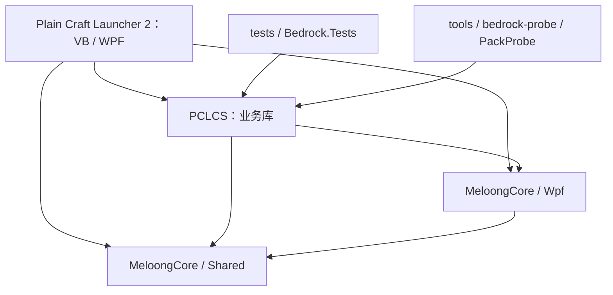

# PCL-X-open 代码索引

整理日期：2026-11-04。本文依据当前工作区的源码和工程引用整理，用于按功能查找文件、核心类型与调用入口。

路径均相对于仓库根目录。WPF 页面与控件的 `.xaml` 定义布局，同名 `.xaml.vb` 实现交互；下表通常链接到代码文件。索引不展开 `bin/`、`obj/`、自动生成代码及 DLL、JAR、ZIP 等二进制内容。代码存在不代表对应功能已完成实机验收。

## 目录

- [1. 项目结构与工程依赖](#1-项目结构与工程依赖)
- [2. 按修改任务快速定位](#2-按修改任务快速定位)
- [3. 程序入口与主窗口](#3-程序入口与主窗口)
- [4. VB 核心模块](#4-vb-核心模块)
- [5. 页面索引](#5-页面索引)
- [6. 自定义控件与行为](#6-自定义控件与行为)
- [7. PCLCS 业务库](#7-pclcs-业务库)
- [8. MeloongCore 公共库](#8-meloongcore-公共库)
- [9. 主要调用链](#9-主要调用链)
- [10. 测试与诊断工具](#10-测试与诊断工具)
- [11. 构建配置与资源](#11-构建配置与资源)
- [12. 相关文档与维护方式](#12-相关文档与维护方式)

## 1. 项目结构与工程依赖

### 1.1 工程入口

主解决方案：[Plain Craft Launcher 2.sln](Plain%20Craft%20Launcher%202.sln)。其中包含以下四个工程：

| 工程 | 技术与目标框架 | 主要职责 |
| --- | --- | --- |
| [Plain Craft Launcher 2](Plain%20Craft%20Launcher%202/Plain%20Craft%20Launcher%202.vbproj) | VB.NET、WPF、.NET Framework 4.8 | 桌面程序、页面、自定义控件，以及启动、下载、资源管理等业务流程；根命名空间为 `PCL` |
| [PCLCS](PCLCS/PCLCS.csproj) | C# 13、`net48` | Java 检测、Minecraft 版本与安装模型、资源映射、基岩版服务；命名空间为 `PCLCS`、`PCLCS.Bedrock` |
| [MeloongCore](MeloongCore/Shared/MeloongCore.csproj) | C# 13、`netstandard2.0` | 配置、日志、任务、文件、字符串等通用能力 |
| [MeloongCore.Wpf](MeloongCore/Wpf/MeloongCore.Wpf.csproj) | C# 13、`net48` | WPF 初始化、对话框、控件扩展及 Windows 适配 |

`MeloongCore/` 是 Git 子模块，其来源由 [.gitmodules](.gitmodules) 指定。根目录的基岩版测试、PackProbe，以及子模块自己的 Tests 工程均为独立工程，未列入上述主解决方案。



### 1.2 目录地图

```text
PCL-X-open-main/
├─ Plain Craft Launcher 2.sln       主解决方案
├─ Plain Craft Launcher 2/          VB/WPF 主程序
│  ├─ Application.xaml[.vb]        应用资源与生命周期
│  ├─ FormMain.xaml[.vb]           主窗口、导航、拖放
│  ├─ Modules/                    核心流程与基础设施
│  │  ├─ Base/                    加载器、网络、动画、校验、日志
│  │  ├─ Minecraft/               Java 版启动、下载、实例、整合包
│  │  ├─ Resource/                本地资源与社区资源
│  │  └─ ThirdParty/              第三方拖放适配
│  ├─ Pages/                      启动、下载、实例、联机、设置、基岩版等页面
│  ├─ Controls/                   自定义控件、弹窗与附加行为
│  ├─ Resources/                  主页示例、字体、帮助、依赖与安装辅助资源
│  ├─ Images/                     图标、头像、主题与皮肤图片
│  └─ My Project/                 程序集元数据与 VB 工程辅助文件
├─ PCLCS/                         C# 业务库
│  ├─ Bedrock/                    基岩版检测、启动、包操作及世界数据服务
│  ├─ Minecraft/                  版本、组件、安装清单
│  ├─ Launch/                     启动辅助与内嵌补丁
│  └─ Resource/                   平台映射及百科条目
├─ MeloongCore/                   公共库子模块：Shared、Wpf、Tests
├─ tests/                         基岩版服务测试与页面 API 兼容检查
├─ tools/bedrock-probe/           Windows 包探针与实验性包布局验证工具
├─ docs/bedrock/                  基岩版设计、测试、范围与交付记录
├─ patches/                       历次版本补丁
└─ .github/workflows/             持续集成配置
```

## 2. 按修改任务快速定位

| 想查找或修改的内容 | 优先阅读 |
| --- | --- |
| 应用初始化、命令行参数、单实例、未处理异常 | [Application.xaml.vb](Plain%20Craft%20Launcher%202/Application.xaml.vb) |
| 顶部导航、页面切换、返回、文件拖放 | [FormMain.xaml.vb](Plain%20Craft%20Launcher%202/FormMain.xaml.vb) |
| Java 版启动、登录、JVM 与游戏参数 | [ModLaunch.vb](Plain%20Craft%20Launcher%202/Modules/Minecraft/ModLaunch.vb) |
| Java 搜索、检查、选择与下载 | [ModJava.vb](Plain%20Craft%20Launcher%202/Modules/Minecraft/ModJava.vb)、[Java.cs](PCLCS/Java.cs) |
| Minecraft 文件夹、实例识别与版本列表 | [ModMinecraft.vb](Plain%20Craft%20Launcher%202/Modules/Minecraft/ModMinecraft.vb)、[PageSelectRight.xaml.vb](Plain%20Craft%20Launcher%202/Pages/PageSelectRight.xaml.vb) |
| 游戏安装、Forge/Fabric 等组件安装与修改 | [PageDownloadInstall.xaml.vb](Plain%20Craft%20Launcher%202/Pages/PageDownload/PageDownloadInstall.xaml.vb)、[ModDownloadLib.vb](Plain%20Craft%20Launcher%202/Pages/PageDownload/ModDownloadLib.vb)、[PageDownloadModify.vb](Plain%20Craft%20Launcher%202/Pages/PageDownload/PageDownloadModify.vb) |
| 下载源、依赖库与资源文件补全、网络重试 | [ModDownload.vb](Plain%20Craft%20Launcher%202/Modules/Minecraft/ModDownload.vb)、[ModNet.vb](Plain%20Craft%20Launcher%202/Modules/Base/ModNet.vb) |
| CurseForge/Modrinth 搜索与资源详情 | [ResourceSearcher.vb](Plain%20Craft%20Launcher%202/Modules/Resource/ResourceSearcher.vb)、[ResourceProject.vb](Plain%20Craft%20Launcher%202/Modules/Resource/ResourceProject.vb)、[ResourceVersion.vb](Plain%20Craft%20Launcher%202/Modules/Resource/ResourceVersion.vb) |
| CurseForge Key、微软登录 Client ID 与请求鉴权 | [ModSecret.vb](Plain%20Craft%20Launcher%202/Modules/ModSecret.vb)、[README.md](README.md) |
| 本地 Mod 管理、整合包导入与导出 | [PageInstanceMod.xaml.vb](Plain%20Craft%20Launcher%202/Pages/PageInstance/PageInstanceMod.xaml.vb)、[ModModpack.vb](Plain%20Craft%20Launcher%202/Modules/Minecraft/ModModpack.vb)、[PageInstanceExport.xaml.vb](Plain%20Craft%20Launcher%202/Pages/PageInstance/PageInstanceExport.xaml.vb) |
| 游戏输出、退出状态与崩溃分析 | [ModWatcher.vb](Plain%20Craft%20Launcher%202/Modules/Minecraft/ModWatcher.vb)、[ModCrash.vb](Plain%20Craft%20Launcher%202/Modules/Minecraft/ModCrash.vb) |
| 联机、邀请信息与联机进程 | [PageLinkMain.xaml.vb](Plain%20Craft%20Launcher%202/Pages/PageLink/PageLinkMain.xaml.vb) |
| 设置键、默认值、配置落盘与控件绑定 | [Settings.vb](Plain%20Craft%20Launcher%202/Pages/PageSetup/Settings.vb)、[SettingService.vb](Plain%20Craft%20Launcher%202/Pages/PageSetup/SettingService.vb)、[Configs.cs](PCLCS/Configs.cs)、[Config.cs](MeloongCore/Shared/General/Config.cs) |
| 主题、主页、动画与公共控件 | [ModSecret.vb](Plain%20Craft%20Launcher%202/Modules/ModSecret.vb)、[PageLaunchRight.xaml.vb](Plain%20Craft%20Launcher%202/Pages/PageLaunch/PageLaunchRight.xaml.vb)、[ModAnimation.vb](Plain%20Craft%20Launcher%202/Modules/Base/ModAnimation.vb)、[Controls/](Plain%20Craft%20Launcher%202/Controls/) |
| 基岩版检测、启动、附加包与备份 | [PageBedrockRight.xaml.vb](Plain%20Craft%20Launcher%202/Pages/PageBedrock/PageBedrockRight.xaml.vb)、[PCLCS/Bedrock/](PCLCS/Bedrock/)、[MVP 范围](docs/bedrock/08-mvp-delivery.md) |

## 3. 程序入口与主窗口

| 文件 | 核心入口或类型 | 职责 |
| --- | --- | --- |
| [Application.xaml](Plain%20Craft%20Launcher%202/Application.xaml) | `StartupUri="FormMain.xaml"` | 应用入口声明、全局资源与样式 |
| [Application.xaml.vb](Plain%20Craft%20Launcher%202/Application.xaml.vb) | `Application_Startup`、`WaitingMutex`、`Application_SessionEnding`、`Application_DispatcherUnhandledException` | 初始化公共库和日志，处理 `--update`、`--gpu`、`--memory` 等参数，检查目录与环境，处理退出和异常 |
| [FormMain.xaml](Plain%20Craft%20Launcher%202/FormMain.xaml) | 主窗口布局、顶部导航按钮、左右页面容器 | 窗口骨架和页面承载 |
| [FormMain.xaml.vb](Plain%20Craft%20Launcher%202/FormMain.xaml.vb) | `New`、`FormMain_Loaded`、`PageType`、`PageSubType`、`PageStackData`、`PageChange`、`PageBack`、`FileDrag` | 初始化主页面、配置迁移、导航栈、切页动画、窗口行为与拖放路由 |
| [ModMain.vb](Plain%20Craft%20Launcher%202/Modules/ModMain.vb) | `Hint`、`HintType`、`MyMsgBox`、`HelpEntry`、`Frm*` 页面字段 | 全局提示、弹窗、页面实例、帮助与周期性 UI 工作 |

`FormMain.PageType` 的数值和导航按钮的 `Tag` 也是自定义事件依赖的标识。变更页面接入时，检查 [check-page-api.ps1](tests/Bedrock.Compatibility/check-page-api.ps1) 中的兼容性约束。

## 4. VB 核心模块

### 4.1 基础设施：`Modules/Base/`

| 文件 | 核心类型或入口 | 职责 |
| --- | --- | --- |
| [ModBase.vb](Plain%20Craft%20Launcher%202/Modules/Base/ModBase.vb) | `BuildTypes`、`MyColor`、`MyRect`、`LoadState`、`ProcessReturnValues`、`SearchEntry`、`RunInUi` | 构建与路径常量、矢量图标、公共数据类型、文件/文本辅助、搜索、线程与 UI 工具 |
| [ModLoader.vb](Plain%20Craft%20Launcher%202/Modules/Base/ModLoader.vb) | `LoaderBase`、`LoaderTask`、`LoaderWorker`、`LoaderCombo`、`LoaderTaskbarAdd` | 后台任务、组合任务、状态/进度、取消，以及任务栏进度管理 |
| [ModNet.vb](Plain%20Craft%20Launcher%202/Modules/Base/ModNet.vb) | `NetRequestByClient*`、`NetFile`、`NetThread`、`LoaderDownload`、`NetManagerClass` | HTTP 请求、重试、多源与多线程下载、限速、下载状态和端口工具 |
| [ModAnimation.vb](Plain%20Craft%20Launcher%202/Modules/Base/ModAnimation.vb) | `AniStart`、`AniStop`、`AniIsRun`、`AniEase*` | 动画调度、属性动画、缓动函数 |
| [ModValidate.vb](Plain%20Craft%20Launcher%202/Modules/Base/ModValidate.vb) | `Validate`、`ValidateRegex`、`ValidateInteger`、`ValidateFileName`、`ValidateFolderPath` 等 | 输入、名称、路径、数值与正则校验 |
| [MyBitmap.vb](Plain%20Craft%20Launcher%202/Modules/Base/MyBitmap.vb) | `MyBitmap`、`WebPDecoder` | 图片封装和 WebP 解码 |
| [PclLogger.vb](Plain%20Craft%20Launcher%202/Modules/Base/PclLogger.vb) | `PclLogger` | 将公共日志能力接入启动器文件日志和界面反馈 |

### 4.2 Minecraft：`Modules/Minecraft/`

| 文件 | 核心类型或入口 | 职责 |
| --- | --- | --- |
| [ModMinecraft.vb](Plain%20Craft%20Launcher%202/Modules/Minecraft/ModMinecraft.vb) | `McFolder`、`McInstance`、`McInstanceLock`、`McFolderListLoader`、`McLib*`、`McAssets*` | 游戏目录与实例模型、版本扫描/分类、实例锁、皮肤、库文件与资源索引；含日志中的账户信息过滤 |
| [ModLaunch.vb](Plain%20Craft%20Launcher%202/Modules/Minecraft/ModLaunch.vb) | `McLaunchOptions`、`McLaunchStart`、`McLaunchLoader`、`McLogin*`、`McLaunchArgumentsJVM`、`McLaunchArgumentsGame` | Java 版启动总流程、各类登录、启动参数、内存、Natives 解压、进程与启动前后处理 |
| [ModJava.vb](Plain%20Craft%20Launcher%202/Modules/Minecraft/ModJava.vb) | `JavaInit`、`GetJavaRequirement`、`SelectOrDownloadJava`、`ManuallyImportJava`、`ManuallySearchJava` | Java 配置迁移、界面联动、版本要求、选择及下载 |
| [ModDownload.vb](Plain%20Craft%20Launcher%202/Modules/Minecraft/ModDownload.vb) | `DlClientFix`、`DlClientListGet`、`DlForge*`、`DlNeoForge*`、`DlSource*` | 原版、OptiFine、Forge、NeoForge、LiteLoader、Fabric 的列表与元数据，库/资源补全及镜像源选择 |
| [ModModpack.vb](Plain%20Craft%20Launcher%202/Modules/Minecraft/ModModpack.vb) | `ModpackInstall` | 整合包识别与不同格式的安装流程 |
| [ModWatcher.vb](Plain%20Craft%20Launcher%202/Modules/Minecraft/ModWatcher.vb) | `Watcher`、`MinecraftState`、`Kill` | 游戏进程、日志与运行状态监视 |
| [ModCrash.vb](Plain%20Craft%20Launcher%202/Modules/Minecraft/ModCrash.vb) | `CrashAnalyzer`、`Collect`、`Import`、`Prepare`、`Analyze`、`Output`、`CrashReason` | 收集并整理崩溃材料、原因分析和报告输出 |

### 4.3 社区与本地资源：`Modules/Resource/`

| 文件 | 核心类型或入口 | 职责 |
| --- | --- | --- |
| [ResourceSearcher.vb](Plain%20Craft%20Launcher%202/Modules/Resource/ResourceSearcher.vb) | `ResourceSearcher`、`SearchRequest`、`SearchResult`、`GetLoader` | 中文搜索、CurseForge/Modrinth 查询、分页、合并去重及排序 |
| [ResourceProject.vb](Plain%20Craft%20Launcher%202/Modules/Resource/ResourceProject.vb) | `ResourceProject`、`FromProjectId`、`ToResourceItem` | 跨平台项目元数据、缓存、展示条目与图标 |
| [ResourceVersion.vb](Plain%20Craft%20Launcher%202/Modules/Resource/ResourceVersion.vb) | `ResourceVersion`、`FromPlatformJson`、`FromProjectId`、`ToNetFile` | 资源版本解析、版本缓存、下载地址与下载任务转换 |
| [LocalResourceFile.vb](Plain%20Craft%20Launcher%202/Modules/Resource/LocalResourceFile.vb) | `LocalResourceFile` | 本地资源文件信息、元数据、联网信息与序列化 |
| [LocalResourceLoaders.vb](Plain%20Craft%20Launcher%202/Modules/Resource/LocalResourceLoaders.vb) | `LocalResourceLoaders` | 本地资源相关的加载工作 |

### 4.4 其他模块

| 文件 | 职责 |
| --- | --- |
| [ModMain.vb](Plain%20Craft%20Launcher%202/Modules/ModMain.vb) | 公共提示、弹窗、页面字段、帮助、任务缓存、反馈和周期任务 |
| [ModEvent.vb](Plain%20Craft%20Launcher%202/Modules/ModEvent.vb) | `CustomEventCollection`、`CustomEventService`、`CustomEvent`、`EventType`；自定义事件的附加属性和触发 |
| [ModMusic.vb](Plain%20Craft%20Launcher%202/Modules/ModMusic.vb) | `MusicStates`、播放列表、音乐播放状态与 UI 控制 |
| [ModSecret.vb](Plain%20Craft%20Launcher%202/Modules/ModSecret.vb) | 开源分支标识、环境变量凭据读取、请求头、主题、更新与联网配置；源文件注明部分私有实现已删除 |
| [ModDevelop.vb](Plain%20Craft%20Launcher%202/Modules/ModDevelop.vb) | `ModDevelop.Start` 开发版入口；当前方法体为空 |
| [DragHelper.vb](Plain%20Craft%20Launcher%202/Modules/ThirdParty/DragHelper.vb) | Windows 拖放适配，供主窗口接入使用 |

## 5. 页面索引

页面均位于 `Plain Craft Launcher 2/Pages/`。名称中的 `Left` 通常是左栏，`Right` 通常是右侧内容区；具体承载关系由 `FormMain` 和各页的导航代码决定。

### 5.1 启动与登录：`PageLaunch/`

| 文件 | 职责 |
| --- | --- |
| [PageLaunchLeft.xaml.vb](Plain%20Craft%20Launcher%202/Pages/PageLaunch/PageLaunchLeft.xaml.vb) | 登录方式切换、账户与皮肤加载、启动按钮、启动进度和取消 |
| [PageLaunchRight.xaml.vb](Plain%20Craft%20Launcher%202/Pages/PageLaunch/PageLaunchRight.xaml.vb) | 主页内容和自定义主页加载 |
| [PageLoginMs.xaml.vb](Plain%20Craft%20Launcher%202/Pages/PageLaunch/PageLoginMs.xaml.vb)、[PageLoginMsSkin.xaml.vb](Plain%20Craft%20Launcher%202/Pages/PageLaunch/PageLoginMsSkin.xaml.vb) | 微软账户登录界面、已登录状态、皮肤与披风 |
| [PageLoginLegacy.xaml.vb](Plain%20Craft%20Launcher%202/Pages/PageLaunch/PageLoginLegacy.xaml.vb) | 离线登录界面 |
| [PageLoginAuth.xaml.vb](Plain%20Craft%20Launcher%202/Pages/PageLaunch/PageLoginAuth.xaml.vb)、[PageLoginAuthSkin.xaml.vb](Plain%20Craft%20Launcher%202/Pages/PageLaunch/PageLoginAuthSkin.xaml.vb) | Authlib-Injector 登录和已登录界面 |
| [PageLoginNide.xaml.vb](Plain%20Craft%20Launcher%202/Pages/PageLaunch/PageLoginNide.xaml.vb)、[PageLoginNideSkin.xaml.vb](Plain%20Craft%20Launcher%202/Pages/PageLaunch/PageLoginNideSkin.xaml.vb) | 统一通行证登录和已登录界面 |
| [MyMsgLogin.xaml.vb](Plain%20Craft%20Launcher%202/Pages/PageLaunch/MyMsgLogin.xaml.vb)、[MySkin.xaml.vb](Plain%20Craft%20Launcher%202/Pages/PageLaunch/MySkin.xaml.vb) | 登录弹窗与皮肤展示控件 |

### 5.2 游戏与资源下载：`PageDownload/`

| 文件 | 职责 |
| --- | --- |
| [PageDownloadLeft.xaml.vb](Plain%20Craft%20Launcher%202/Pages/PageDownload/PageDownloadLeft.xaml.vb) | 下载页面导航和分类切换 |
| [PageDownloadInstall.xaml.vb](Plain%20Craft%20Launcher%202/Pages/PageDownload/PageDownloadInstall.xaml.vb) | 选择原版与组件、兼容性提示、`GetSelectedComponents` 和 `StartInstall` |
| [PageDownloadModify.vb](Plain%20Craft%20Launcher%202/Pages/PageDownload/PageDownloadModify.vb) | 继承 `PageDownloadInstall`，读取已安装组件和安装清单，复用选择交互来修改实例 |
| [ModDownloadLib.vb](Plain%20Craft%20Launcher%202/Pages/PageDownload/ModDownloadLib.vb) | 安装编排；`McInstallRequest`、`McInstallLoadersGet`、`McInstallStart`、`McModificationStart`、`McInstallCommit`，以及各组件的下载/安装辅助 |
| [Resource/PageResource.xaml.vb](Plain%20Craft%20Launcher%202/Pages/PageDownload/Resource/PageResource.xaml.vb) | 社区资源列表、加载与搜索的公共页面逻辑 |
| [Resource/PageDownloadMod.xaml.vb](Plain%20Craft%20Launcher%202/Pages/PageDownload/Resource/PageDownloadMod.xaml.vb) | Mod 下载分类 |
| [Resource/PageDownloadPack.xaml.vb](Plain%20Craft%20Launcher%202/Pages/PageDownload/Resource/PageDownloadPack.xaml.vb) | 整合包下载分类 |
| [Resource/PageDownloadResourcePack.xaml.vb](Plain%20Craft%20Launcher%202/Pages/PageDownload/Resource/PageDownloadResourcePack.xaml.vb) | 资源包下载分类 |
| [Resource/PageDownloadShader.xaml.vb](Plain%20Craft%20Launcher%202/Pages/PageDownload/Resource/PageDownloadShader.xaml.vb) | 光影下载分类 |
| [Resource/PageDownloadDataPack.xaml.vb](Plain%20Craft%20Launcher%202/Pages/PageDownload/Resource/PageDownloadDataPack.xaml.vb) | 数据包下载分类 |
| [Resource/PageDownloadCompDetail.xaml.vb](Plain%20Craft%20Launcher%202/Pages/PageDownload/Resource/PageDownloadCompDetail.xaml.vb) | 社区资源详情与版本加载 |
| [Resource/MyResourceItem.xaml.vb](Plain%20Craft%20Launcher%202/Pages/PageDownload/Resource/MyResourceItem.xaml.vb) | 社区资源列表条目与点击交互 |

安装业务的一部分放在页面目录中的 `ModDownloadLib.vb`，修改安装逻辑时需要同时检查它与 `Modules/Minecraft/ModDownload.vb`。

### 5.3 实例管理：`PageInstance/`

| 文件 | 职责 |
| --- | --- |
| [PageInstanceLeft.xaml.vb](Plain%20Craft%20Launcher%202/Pages/PageInstance/PageInstanceLeft.xaml.vb) | 当前实例与实例设置子页面导航 |
| [PageInstanceOverall.xaml.vb](Plain%20Craft%20Launcher%202/Pages/PageInstance/PageInstanceOverall.xaml.vb) | 实例总览、个性化、快捷方式和管理操作 |
| [PageInstanceSetup.xaml.vb](Plain%20Craft%20Launcher%202/Pages/PageInstance/PageInstanceSetup.xaml.vb) | 实例级内存、Java、服务器与启动设置 |
| [PageInstanceMod.xaml.vb](Plain%20Craft%20Launcher%202/Pages/PageInstance/PageInstanceMod.xaml.vb) | 本地 Mod 列表、筛选、选择、搜索与管理 |
| [PageInstanceModDisabled.xaml.vb](Plain%20Craft%20Launcher%202/Pages/PageInstance/PageInstanceModDisabled.xaml.vb) | Mod 管理不可用时的说明页面 |
| [MyLocalModItem.xaml.vb](Plain%20Craft%20Launcher%202/Pages/PageInstance/MyLocalModItem.xaml.vb) | 本地 Mod 条目、勾选、点击和延迟加载内容 |
| [PageInstanceExport.xaml.vb](Plain%20Craft%20Launcher%202/Pages/PageInstance/PageInstanceExport.xaml.vb) | 导出选项、配置准备、文件复制、联网检查及整合包压缩 |

### 5.4 设置：`PageSetup/`

| 文件 | 职责 |
| --- | --- |
| [PageSetupLeft.xaml.vb](Plain%20Craft%20Launcher%202/Pages/PageSetup/PageSetupLeft.xaml.vb) | 设置分类导航 |
| [PageSetupLaunch.xaml.vb](Plain%20Craft%20Launcher%202/Pages/PageSetup/PageSetupLaunch.xaml.vb) | 全局游戏启动、Java、内存、离线皮肤和高级参数设置 |
| [PageSetupUI.xaml.vb](Plain%20Craft%20Launcher%202/Pages/PageSetup/PageSetupUI.xaml.vb) | 启动器界面与功能显示设置 |
| [PageSetupSystem.xaml.vb](Plain%20Craft%20Launcher%202/Pages/PageSetup/PageSetupSystem.xaml.vb) | 系统选项及设置导入、导出 |
| [PageSetupLink.xaml.vb](Plain%20Craft%20Launcher%202/Pages/PageSetup/PageSetupLink.xaml.vb) | 联机设置的刷新与重置 |
| [Settings.vb](Plain%20Craft%20Launcher%202/Pages/PageSetup/Settings.vb) | 既有设置系统、键与默认值、来源、缓存及读写；包含实例相关设置 |
| [SettingService.vb](Plain%20Craft%20Launcher%202/Pages/PageSetup/SettingService.vb) | 设置控件的附加属性、`ISettingControl`、`RefreshSettings`、`SaveSetting`、`ResetSettings` |

既有 VB `Settings` 与 C# `Configs`/MeloongCore 配置系统并存。新增或迁移配置时，先确认相关页面使用哪套入口。

### 5.5 联机、其他、选择与任务页面

| 文件 | 职责 |
| --- | --- |
| [PageLink/PageLinkMain.xaml.vb](Plain%20Craft%20Launcher%202/Pages/PageLink/PageLinkMain.xaml.vb) | 联机状态机 `LinkStates`、邀请流程、加载器、进程/日志、CLI 节点信息及定时工作 |
| [PageOther/PageOtherLeft.xaml.vb](Plain%20Craft%20Launcher%202/Pages/PageOther/PageOtherLeft.xaml.vb) | 其他页面的分类导航 |
| [PageOther/PageOtherAbout.xaml.vb](Plain%20Craft%20Launcher%202/Pages/PageOther/PageOtherAbout.xaml.vb) | 关于页面 |
| [PageOther/PageOtherHelp.xaml.vb](Plain%20Craft%20Launcher%202/Pages/PageOther/PageOtherHelp.xaml.vb)、[PageOtherHelpDetail.xaml.vb](Plain%20Craft%20Launcher%202/Pages/PageOther/PageOtherHelpDetail.xaml.vb) | 帮助列表与详情 |
| [PageOther/PageOtherTest.xaml.vb](Plain%20Craft%20Launcher%202/Pages/PageOther/PageOtherTest.xaml.vb) | 工具页面，包含内存优化等操作 |
| [PageSelectLeft.xaml.vb](Plain%20Craft%20Launcher%202/Pages/PageSelectLeft.xaml.vb)、[PageSelectRight.xaml.vb](Plain%20Craft%20Launcher%202/Pages/PageSelectRight.xaml.vb) | Minecraft 文件夹与实例选择、版本卡片展示 |
| [PageSpeedLeft.xaml.vb](Plain%20Craft%20Launcher%202/Pages/PageSpeedLeft.xaml.vb)、[PageSpeedRight.xaml.vb](Plain%20Craft%20Launcher%202/Pages/PageSpeedRight.xaml.vb) | 下载/后台任务管理及任务进度展示 |

### 5.6 基岩版：`PageBedrock/`

界面：[PageBedrockRight.xaml](Plain%20Craft%20Launcher%202/Pages/PageBedrock/PageBedrockRight.xaml)。交互：[PageBedrockRight.xaml.vb](Plain%20Craft%20Launcher%202/Pages/PageBedrock/PageBedrockRight.xaml.vb)。

| 入口 | 对应功能 |
| --- | --- |
| `RefreshInstallations`、`StartClicked` | 检测 Windows 注册安装并请求系统激活 |
| `PreviewPackage`、`PreviewPackageFolder` | 压缩包或文件夹的只读预览，也供主窗口拖放调用 |
| `InstallPackClicked`、`PrepareSupportedPacks`、`ValidateInstallTarget` | 准备待安装包、检查目标与依赖、执行安装 |
| `ReadAddonsClicked`、`RemoveAddonClicked`、`RestoreRemovalClicked` | 已安装包列表、移除与恢复 |
| `ListTransactionsClicked`、`RollbackTransactionClicked` | 事务记录和回滚 |
| `ReadWorldsClicked`、`ReadWorldAddonsClicked`、`ChangeWorldAddon`、`RestoreWorldConfigClicked` | 世界与附加包引用、实验性世界配置操作 |
| `BackupClicked`、`RestoreClicked` | 世界备份及恢复 |
| `RefreshInstallPackButton`、`RefreshWorldAddonButtons` | 根据当前选择及能力规则控制操作入口 |

业务实现见下文 `PCLCS/Bedrock/`。实验性写入入口受 [BedrockCapabilities.cs](PCLCS/Bedrock/BedrockCapabilities.cs) 限制，支持与验收范围以 [08-mvp-delivery.md](docs/bedrock/08-mvp-delivery.md) 为准。

## 6. 自定义控件与行为

均位于 `Plain Craft Launcher 2/Controls/`。有同名 XAML 的控件需同时查看布局与代码。

| 分类 | 文件与职责 |
| --- | --- |
| 普通按钮 | [MyButton.xaml.vb](Plain%20Craft%20Launcher%202/Controls/MyButton.xaml.vb)、[MyTextButton.vb](Plain%20Craft%20Launcher%202/Controls/MyTextButton.vb) |
| 图标按钮 | [MyIconButton.xaml.vb](Plain%20Craft%20Launcher%202/Controls/MyIconButton.xaml.vb)、[MyIconTextButton.xaml.vb](Plain%20Craft%20Launcher%202/Controls/MyIconTextButton.xaml.vb) |
| 附加操作按钮 | [MyExtraButton.xaml.vb](Plain%20Craft%20Launcher%202/Controls/MyExtraButton.xaml.vb)、[MyExtraTextButton.xaml.vb](Plain%20Craft%20Launcher%202/Controls/MyExtraTextButton.xaml.vb) |
| 选择控件 | [MyCheckBox.xaml.vb](Plain%20Craft%20Launcher%202/Controls/MyCheckBox.xaml.vb)、[MyRadioBox.xaml.vb](Plain%20Craft%20Launcher%202/Controls/MyRadioBox.xaml.vb)、[MyRadioButton.xaml.vb](Plain%20Craft%20Launcher%202/Controls/MyRadioButton.xaml.vb) |
| 文本与搜索输入 | [MyTextBox.vb](Plain%20Craft%20Launcher%202/Controls/MyTextBox.vb)、[MySearchBox.xaml.vb](Plain%20Craft%20Launcher%202/Controls/MySearchBox.xaml.vb)；文本校验状态与搜索交互 |
| 下拉框与菜单 | [MyComboBox.vb](Plain%20Craft%20Launcher%202/Controls/MyComboBox.vb)、[MyComboBoxItem.vb](Plain%20Craft%20Launcher%202/Controls/MyComboBoxItem.vb)、[MyMenuItem.vb](Plain%20Craft%20Launcher%202/Controls/MyMenuItem.vb) |
| 滑块 | [MySlider.xaml.vb](Plain%20Craft%20Launcher%202/Controls/MySlider.xaml.vb)、[MySliderDot.xaml.vb](Plain%20Craft%20Launcher%202/Controls/MySliderDot.xaml.vb) |
| 卡片与列表 | [MyCard.vb](Plain%20Craft%20Launcher%202/Controls/MyCard.vb)、[MyListItem.xaml.vb](Plain%20Craft%20Launcher%202/Controls/MyListItem.xaml.vb)、[MyVirtualizingElement.vb](Plain%20Craft%20Launcher%202/Controls/MyVirtualizingElement.vb)；卡片展开、列表条目与虚拟元素 |
| 图片、提示与阴影 | [MyImage.vb](Plain%20Craft%20Launcher%202/Controls/MyImage.vb)、[MyHint.xaml.vb](Plain%20Craft%20Launcher%202/Controls/MyHint.xaml.vb)、[MyDropShadow.vb](Plain%20Craft%20Launcher%202/Controls/MyDropShadow.vb) |
| 加载状态 | [MyLoading.xaml.vb](Plain%20Craft%20Launcher%202/Controls/MyLoading.xaml.vb)；`MyLoadingState`、`ILoadingTrigger` 等 |
| 页面基类 | [MyPageLeft.vb](Plain%20Craft%20Launcher%202/Controls/MyPageLeft.vb)、[MyPageRight.vb](Plain%20Craft%20Launcher%202/Controls/MyPageRight.vb)；页面生命周期、加载状态及切换 |
| 滚动与窗口尺寸 | [MyScrollViewer.vb](Plain%20Craft%20Launcher%202/Controls/MyScrollViewer.vb)、[MyScrollBar.vb](Plain%20Craft%20Launcher%202/Controls/MyScrollBar.vb)、[MyResizer.vb](Plain%20Craft%20Launcher%202/Controls/MyResizer.vb) |
| 弹窗 | [MyMsgText.xaml.vb](Plain%20Craft%20Launcher%202/Controls/MyMsg/MyMsgText.xaml.vb)、[MyMsgInput.xaml.vb](Plain%20Craft%20Launcher%202/Controls/MyMsg/MyMsgInput.xaml.vb)、[MyMsgSelect.xaml.vb](Plain%20Craft%20Launcher%202/Controls/MyMsg/MyMsgSelect.xaml.vb)；文本、输入与选择弹窗 |
| 剪贴板行为 | [ClipboardInterceptor.vb](Plain%20Craft%20Launcher%202/Controls/Behaviors/ClipboardInterceptor.vb)；处理 WPF 剪贴板访问异常 |
| 延迟加载行为 | [LazyLoadBehavior.vb](Plain%20Craft%20Launcher%202/Controls/Behaviors/LazyLoadBehavior.vb)；首次进入滚动视口时触发操作 |
| 公共接口 | [Interfaces.vb](Plain%20Craft%20Launcher%202/Controls/Behaviors/Interfaces.vb)；`IRefreshable`、`IDispatcherUnhandledException`、`IMyRadio` |

## 7. PCLCS 业务库

### 7.1 通用业务与 Java 版

| 文件 | 核心类型或入口 | 职责 |
| --- | --- | --- |
| [Configs.cs](PCLCS/Configs.cs) | `Configs`、`McInstallManifest`、`JavaList`、`JavaForced`、`JavaConfigVersion` | 强类型配置项与 Java 配置状态 |
| [Constants.cs](PCLCS/Constants.cs) | `ResourceTypes`、`ResourcePlatforms`、`ModLoaders`、`DonationRank`、`Versions` | 跨 VB/C# 使用的枚举与版本常量 |
| [Java.cs](PCLCS/Java.cs) | `Java`、`JavaUtils`、`CheckAsync`、`RefreshListAsync`、`SearchFoldersAsync` | Java 实例、版本与编码检查、搜索、排序、列表刷新 |
| [Minecraft/McVersion.cs](PCLCS/Minecraft/McVersion.cs) | `McVersion`、`NameToVersion`、`VersionToDrop`、`DropToVersion` | Minecraft 版本号、Drop 与组件信息 |
| [Minecraft/MCUtils.cs](PCLCS/Minecraft/MCUtils.cs) | `McUtils.CompareVersion`、`CompareVersionGE` | Minecraft 版本比较工具 |
| [Minecraft/McInstallManifest.cs](PCLCS/Minecraft/McInstallManifest.cs) | `McInstallManifest`、`ManagedFile`、`McComponents`、`RefreshModComponents` | 安装清单、目标组件、受管理文件和失效组件记录刷新 |
| [Launch/LaunchUtils.cs](PCLCS/Launch/LaunchUtils.cs) | `LaunchUtils.ExtractPatch` | 释放内嵌启动辅助补丁 |
| [Resource/Resource.cs](PCLCS/Resource/Resource.cs) | `FromCurseForgeModLoaderType`、`ToCurseForgeModLoaderType` | CurseForge 与内部 Mod Loader 枚举转换 |
| [Resource/WikiEntry.cs](PCLCS/Resource/WikiEntry.cs) | `WikiEntry`、`WikiEntry.All` | 读取内嵌百科条目，提供中文译名、平台 Slug 与热度信息 |

### 7.2 基岩版：检测与平台适配

均位于 `PCLCS/Bedrock/`，命名空间为 `PCLCS.Bedrock`。

| 文件 | 核心类型或入口 | 职责 |
| --- | --- | --- |
| [BedrockService.cs](PCLCS/Bedrock/BedrockService.cs) | `BedrockInstallation`、`BedrockDetectionResult`、`BedrockLaunchResult`、`BedrockService.Detect/Launch` | 安装与结果模型、平台抽象、检测、启动前重新校验注册信息 |
| [WindowsBedrockPlatform.cs](PCLCS/Bedrock/WindowsBedrockPlatform.cs) | `WindowsBedrockPackageCatalog`、`WindowsBedrockActivator` | Windows 包查询、安装元数据读取与系统应用激活 |
| [BedrockCapabilities.cs](PCLCS/Bedrock/BedrockCapabilities.cs) | `CanManageResourcePacks`、`CanEditWorldPacks` | 实验性操作的安装身份、版本与数据根条件；当前匹配规则针对 `1.26.5203.0` 的特定 x64 包 |
| [BedrockWorldReader.cs](PCLCS/Bedrock/BedrockWorldReader.cs) | `BedrockDataRootKind`、`BedrockDataRootFinder.Find`、`BedrockWorldReader.Read` | 查找候选数据根，区分旧 UWP、GDK 账户与共享目录，读取世界与引用信息 |
| [AssemblyInfo.cs](PCLCS/Bedrock/AssemblyInfo.cs) | `InternalsVisibleTo("Bedrock.Tests")` | 允许独立测试工程访问内部类型 |

系统激活结果 `Accepted` 和返回 PID 表示系统接受了请求，不表示游戏已进入可玩状态。候选目录也不等于已确认的当前游戏数据目录。

### 7.3 基岩版：包预览、安装、移除与恢复

| 文件 | 核心入口 | 职责 |
| --- | --- | --- |
| [BedrockPackInspector.cs](PCLCS/Bedrock/BedrockPackInspector.cs) | `BedrockPackInfo`、`Inspect`、`InspectDirectory` | `.mcpack`/`.mcaddon` 或目录的清单、UUID、版本、包类型与路径检查 |
| [BedrockPackLocalization.cs](PCLCS/Bedrock/BedrockPackLocalization.cs) | `BedrockPackLocalization` | 解析包名称、描述等本地化文本 |
| [BedrockArchivePreparer.cs](PCLCS/Bedrock/BedrockArchivePreparer.cs) | `PrepareMcpack`、`PrepareMcaddon`、`BedrockPreparedPack` | 在暂存目录准备压缩包内容，支持多包附加包 |
| [BedrockDirectoryInstaller.cs](PCLCS/Bedrock/BedrockDirectoryInstaller.cs) | `Preview`、`Install`、`BedrockDirectoryPreview` | 包目录预览、指纹与单目录安装 |
| [BedrockAddonCatalog.cs](PCLCS/Bedrock/BedrockAddonCatalog.cs) | `BedrockInstalledAddon`、`Read` | 读取数据根下已安装的附加包 |
| [BedrockAddonScope.cs](PCLCS/Bedrock/BedrockAddonScope.cs) | `Check`、`BedrockAddonScopeResult` | 跨候选数据根检查 UUID 冲突及扫描完整性 |
| [BedrockDependencyCheck.cs](PCLCS/Bedrock/BedrockDependencyCheck.cs) | `Analyze`、`Equivalent` | 依赖满足情况与复查结果比较 |
| [BedrockAddonTransaction.cs](PCLCS/Bedrock/BedrockAddonTransaction.cs) | `List`、`Prepare`、`Commit`、`Rollback` | 多包安装事务、记录、提交和回滚 |
| [BedrockAddonRemoval.cs](PCLCS/Bedrock/BedrockAddonRemoval.cs) | `List`、`Remove`、`Restore`、`RestoreFromBackup`、`RestoreFromSelectedBackup` | 包移除、隔离记录、外部备份与恢复 |
| [BedrockAddonDependents.cs](PCLCS/Bedrock/BedrockAddonDependents.cs) | `Check` | 检查其他已安装包对目标包的依赖 |
| [BedrockGlobalPackUsage.cs](PCLCS/Bedrock/BedrockGlobalPackUsage.cs) | `Check` | 全局资源包配置引用检查 |
| [BedrockWorldPackUsage.cs](PCLCS/Bedrock/BedrockWorldPackUsage.cs) | `Check` | 世界对附加包的引用及不完整扫描结果 |
| [BedrockRootLock.cs](PCLCS/Bedrock/BedrockRootLock.cs) | `Acquire`、`AcquireAll` | 数据根操作锁 |
| [BedrockOperationScope.cs](PCLCS/Bedrock/BedrockOperationScope.cs) | `Acquire` | 在同一操作范围内持有多个候选数据根的锁 |

### 7.4 基岩版：世界备份与实验性配置

| 文件 | 核心入口 | 职责 |
| --- | --- | --- |
| [BedrockWorldBackup.cs](PCLCS/Bedrock/BedrockWorldBackup.cs) | `Create`、`Verify`、`RestoreAsNew` | 创建和验证世界备份，以新世界目录恢复 |
| [BedrockWorldPackEditor.cs](PCLCS/Bedrock/BedrockWorldPackEditor.cs) | `Read`、`SetEnabled`、`Restore`、`BedrockWorldPackSnapshot` | 世界包配置快照、引用修改、备份恢复与并发变化检查 |
| [BedrockWorldDependencyCheck.cs](PCLCS/Bedrock/BedrockWorldDependencyCheck.cs) | `Check`、`Equivalent` | 世界包依赖、版本与快照复查 |
| [BedrockWorldDependents.cs](PCLCS/Bedrock/BedrockWorldDependents.cs) | `Check`、`Equivalent` | 世界内反向依赖及变更检查 |

复杂世界配置、历史版本部署、多实例和原生 Mod 不属于当前 MVP 的交付范围。以上条目是已有代码的位置说明，验收边界见 [MVP 交付范围](docs/bedrock/08-mvp-delivery.md)。

## 8. MeloongCore 公共库

子模块使用独立的 [AGENTS.md](MeloongCore/AGENTS.md)。通用逻辑优先查 `Shared/`，Windows/WPF 适配查 `Wpf/`。

### 8.1 Shared

| 文件或目录 | 职责 |
| --- | --- |
| [Main.cs](MeloongCore/Shared/Main.cs) | `MeloongCore.Main.Init`，公共库初始化 |
| [General/Config.cs](MeloongCore/Shared/General/Config.cs) | `ConfigEntry<T>`、`DynamicConfigEntry<T>`、配置 Provider、JSON 配置与保存 |
| [General/Logger.cs](MeloongCore/Shared/General/Logger.cs) | 日志抽象、日志行为与文件日志 |
| [General/Progress.cs](MeloongCore/Shared/General/Progress.cs) | `ProgressProvider`、`ProgressObserver`，分阶段进度与观测 |
| [General/Worker/RateLimitedWorker.cs](MeloongCore/Shared/General/Worker/RateLimitedWorker.cs) | 节流与防抖工作器 |
| [General/Worker/RedoableWorker.cs](MeloongCore/Shared/General/Worker/RedoableWorker.cs) | 可取消并合并重跑的工作器 |
| [General/ConcurrentList.cs](MeloongCore/Shared/General/ConcurrentList.cs)、[OneOf.cs](MeloongCore/Shared/General/OneOf.cs)、[ValueRange.cs](MeloongCore/Shared/General/ValueRange.cs) | 并发列表、联合值与范围模型 |
| [General/MsDelta.cs](MeloongCore/Shared/General/MsDelta.cs) | Windows 增量补丁能力 |
| [Utils/FileUtils.cs](MeloongCore/Shared/Utils/FileUtils.cs)、[DirectoryUtils.cs](MeloongCore/Shared/Utils/DirectoryUtils.cs)、[PathUtils.cs](MeloongCore/Shared/Utils/PathUtils.cs) | 文件、压缩、目录、路径及应用目录 |
| [Utils/TaskUtils.cs](MeloongCore/Shared/Utils/TaskUtils.cs) | 异步任务、并发与外部进程执行 |
| [Utils/CryptographyUtils.cs](MeloongCore/Shared/Utils/CryptographyUtils.cs) | 加密与相关工具 |
| [Utils/RegistryUtils.cs](MeloongCore/Shared/Utils/RegistryUtils.cs) | Windows 注册表访问 |
| [Utils/StringUtils.cs](MeloongCore/Shared/Utils/StringUtils.cs)、[MathUtils.cs](MeloongCore/Shared/Utils/MathUtils.cs)、[EnumUtils.cs](MeloongCore/Shared/Utils/EnumUtils.cs)、[GeneralUtils.cs](MeloongCore/Shared/Utils/GeneralUtils.cs) | 文本、数学、枚举及通用辅助 |
| [Utils/WebUtils.cs](MeloongCore/Shared/Utils/WebUtils.cs) | HTTP 请求错误类型 |
| [Extensions/EnumerableExtensions.cs](MeloongCore/Shared/Extensions/EnumerableExtensions.cs) | 集合与枚举扩展 |
| [Extensions/StringExtensions.cs](MeloongCore/Shared/Extensions/StringExtensions.cs) | 字符串、编码、正则与 JSON 相关扩展 |
| [Extensions/ExceptionExtensions.cs](MeloongCore/Shared/Extensions/ExceptionExtensions.cs)、[TaskExtensions.cs](MeloongCore/Shared/Extensions/TaskExtensions.cs)、[WebExtensions.cs](MeloongCore/Shared/Extensions/WebExtensions.cs) | 异常、Task 与 HTTP 对象扩展 |

需要复用某个入口前，可先查阅 [Shared 复用指南](MeloongCore/.agents/Shared/架构分析.md) 中的线程、缓存、取消与集合语义。`Shared` 的目标框架不意味着其中所有 Windows 专用入口均可跨平台使用。

### 8.2 Wpf

| 文件 | 职责 |
| --- | --- |
| [Main.cs](MeloongCore/Wpf/Main.cs) | `MeloongCore.Wpf.Main.Init`，WPF 初始化 |
| [Controls/ModernTooltipService.cs](MeloongCore/Wpf/Controls/ModernTooltipService.cs) | ToolTip 附加行为 |
| [Extensions/WpfExtensions.cs](MeloongCore/Wpf/Extensions/WpfExtensions.cs) | WPF 控件和对象扩展 |
| [General/Dialogs.cs](MeloongCore/Wpf/General/Dialogs.cs) | 文件、文件夹与消息对话框 |
| [General/ValueConverters.cs](MeloongCore/Wpf/General/ValueConverters.cs) | Binding 值转换器 |
| [Utils/WindowsUtils.cs](MeloongCore/Wpf/Utils/WindowsUtils.cs) | Windows 权限、窗口及系统操作 |

构建与平台注意事项见 [Wpf 说明](MeloongCore/.agents/Wpf/架构分析.md)。

## 9. 主要调用链

以下为帮助阅读的主路径，省略分支、重试与异常处理；实际执行次序以源码为准。

### 9.1 应用启动与页面切换

```text
Application.xaml / Application_Startup
  → MeloongCore.Main.Init / MeloongCore.Wpf.Main.Init
  → 单实例、日志、参数、目录与环境检查
  → FormMain.New / FormMain_Loaded
  → PageLaunchLeft + PageLaunchRight

顶部导航 / 自定义事件
  → FormMain.PageChange
  → PageChangeActual / PageChangeAnim
  → 目标页面及左右栏
```

### 9.2 Java 版启动

```text
PageLaunchLeft
  → ModLaunch.McLaunchStart(options)         UI 线程入口
  → McLaunchLoader / McLaunchPrecheck
  → McLaunchLoaderReal（LoaderCombo）
      获取 Java / McLoginLoader / DlClientFix
      → McLaunchArgumentMain
      → McLaunchNatives / McLaunchPrerun / McLaunchCustom
      → McLaunchRun / McLaunchWait / McLaunchEnd
  → Watcher 监视游戏，CrashAnalyzer 分析异常材料
```

### 9.3 安装、修改与社区资源

```text
PageDownloadInstall / PageDownloadModify
  → McInstallRequest
  → ModDownloadLib.McInstallStart / McModificationStart
  → McInstallLoadersGet 与各组件安装流程
  → McInstallCommit / McInstallManifest

PageResource / PageDownloadCompDetail
  → ResourceSearcher.GetLoader / ResourceProject / ResourceVersion
  → CurseForge、Modrinth 元数据与版本
  → NetFile / LoaderDownload / ModNet
```

### 9.4 基岩版

```text
FormMain.PageChange / FileDrag
  → PageBedrockRight
      检测与启动 → BedrockService → WindowsBedrockPackageCatalog / WindowsBedrockActivator
      文件预览   → BedrockPackInspector
      安装       → ArchivePreparer / DirectoryInstaller / AddonScope / DependencyCheck
                 → AddonTransaction.Prepare / Commit
      移除与恢复 → AddonRemoval + 包依赖、全局引用与世界引用检查
      世界数据   → WorldReader / WorldBackup / WorldPackEditor
```

## 10. 测试与诊断工具

### 10.1 启动器仓库内的测试

| 文件 | 覆盖内容或用途 |
| --- | --- |
| [tests/Bedrock.Tests/Bedrock.Tests.csproj](tests/Bedrock.Tests/Bedrock.Tests.csproj) | 引用 PCLCS 的 `net48` 独立可执行测试工程 |
| [BedrockServiceTests.cs](tests/Bedrock.Tests/BedrockServiceTests.cs) | `Main` 注册并运行测试；包含检测、注册变化、激活结果及测试断言辅助 |
| [BedrockPackInspectorTests.cs](tests/Bedrock.Tests/BedrockPackInspectorTests.cs) | 包解析、本地化、安全路径、安装、事务、移除/恢复、依赖和跨根冲突 |
| [BedrockWorldReaderTests.cs](tests/Bedrock.Tests/BedrockWorldReaderTests.cs) | 数据根、世界读取、备份验证、恢复、能力限制与世界引用 |
| [BedrockWorldPackEditorTests.cs](tests/Bedrock.Tests/BedrockWorldPackEditorTests.cs) | 世界配置修改、快照、备份恢复、依赖及操作锁 |
| [TestPaths.cs](tests/Bedrock.Tests/TestPaths.cs) | 临时测试目录清理辅助 |
| [tests/Bedrock.Compatibility/check-page-api.ps1](tests/Bedrock.Compatibility/check-page-api.ps1) | 通过反射及 XAML 检查公开 `PageType` 数值和主导航 `Tag` |

基岩版服务测试通过 `dotnet run` 执行自带的入口，新增测试方法时还需在 `BedrockServiceTests.Main` 的用例列表中登记。

### 10.2 MeloongCore 的独立测试

工程：[MeloongCore.Tests.csproj](MeloongCore/Tests/MeloongCore.Tests.csproj)。这是 TUnit 可执行测试工程，引用 Shared 和 Wpf，主要覆盖 Shared。

| 文件或目录 | 覆盖内容 |
| --- | --- |
| [General/ConfigTest.cs](MeloongCore/Tests/General/ConfigTest.cs)、[ProgressTest.cs](MeloongCore/Tests/General/ProgressTest.cs)、[WorkerTest.cs](MeloongCore/Tests/General/WorkerTest.cs) | 配置、进度与后台工作器 |
| [Utils/CryptographyUtilsTest.cs](MeloongCore/Tests/Utils/CryptographyUtilsTest.cs)、[DirectoryUtilsTest.cs](MeloongCore/Tests/Utils/DirectoryUtilsTest.cs)、[FileUtilsTest.cs](MeloongCore/Tests/Utils/FileUtilsTest.cs) | 加密、目录、文件与压缩 |
| [Utils/PathUtilsTest.cs](MeloongCore/Tests/Utils/PathUtilsTest.cs)、[TaskUtilsTest.cs](MeloongCore/Tests/Utils/TaskUtilsTest.cs) | 路径、任务与进程 |
| [TestUtils.cs](MeloongCore/Tests/TestUtils.cs)、[TestFiles/](MeloongCore/Tests/TestFiles/) | 初始化、日志、临时目录及测试样本 |

测试环境说明：[Tests 说明](MeloongCore/.agents/Tests/架构分析.md)。

### 10.3 基岩版探针

| 文件 | 用途 |
| --- | --- |
| [Get-BedrockPackageInfo.ps1](tools/bedrock-probe/Get-BedrockPackageInfo.ps1) | 当前 Windows 用户的只读包查询，输出包与清单元数据；说明见 [README](tools/bedrock-probe/README.md) |
| [PackProbe/Program.cs](tools/bedrock-probe/PackProbe/Program.cs) | `list`、`fixture`、`fixture-addon`、`plan`、`install`、`rollback`；创建自制测试包并验证实验性布局 |
| [PackProbe.csproj](tools/bedrock-probe/PackProbe/PackProbe.csproj) | 引用 PCLCS 的独立 `net48` 探针工程；操作约定见 [PackProbe README](tools/bedrock-probe/PackProbe/README.md) |

`PackProbe` 的 `install`、`rollback` 会修改选定的游戏数据根；执行前需按其 README 完成目标确认。服务测试通过也不能替代真实游戏与启动器界面的端到端验收。

## 11. 构建配置与资源

### 11.1 构建入口

持续集成配置：[.github/workflows/build.yml](.github/workflows/build.yml)。流程包含子模块检出、NuGet 恢复、Debug/Release 构建、基岩版测试、页面 API 检查及 PackProbe 构建。

在仓库根目录、已配置 Visual Studio MSBuild 和支持 C# 13 的 .NET SDK 的终端中，可参照 CI 使用：

```powershell
git submodule update --init --recursive
dotnet restore .\PCLCS\PCLCS.csproj
msbuild ".\Plain Craft Launcher 2\Plain Craft Launcher 2.vbproj" -p:Configuration=Debug
dotnet run --project .\tests\Bedrock.Tests\Bedrock.Tests.csproj --configuration Debug
powershell.exe -NoProfile -File .\tests\Bedrock.Compatibility\check-page-api.ps1 -ExecutablePath ".\Plain Craft Launcher 2\obj\Debug\Plain Craft Launcher 2.exe" -FormXamlPath ".\Plain Craft Launcher 2\FormMain.xaml"
dotnet build .\tools\bedrock-probe\PackProbe\PackProbe.csproj --configuration Debug
```

这些是工程/CI 中的构建与检查入口，本文生成时未重新运行构建或功能测试。主解决方案还声明了 `Snapshot` 配置；各配置常量与输出目录以相应工程文件为准。

### 11.2 配置、资源与工程辅助文件

| 文件或目录 | 用途 |
| --- | --- |
| [App.config](Plain%20Craft%20Launcher%202/App.config) | 运行时配置、网络设置及程序集绑定重定向 |
| [app.manifest](Plain%20Craft%20Launcher%202/app.manifest)、[My Project/app.manifest](Plain%20Craft%20Launcher%202/My%20Project/app.manifest) | Windows 应用清单；实际采用项查看 VB 工程的 `ApplicationManifest` 配置 |
| [My Project/AssemblyInfo.vb](Plain%20Craft%20Launcher%202/My%20Project/AssemblyInfo.vb) | 程序集元数据 |
| [My Project/Resources.resx](Plain%20Craft%20Launcher%202/My%20Project/Resources.resx)、[Settings.settings](Plain%20Craft%20Launcher%202/My%20Project/Settings.settings) | VB 资源和工程设置定义，对应 Designer 文件由工具生成 |
| [MyWpfExtension.vb](Plain%20Craft%20Launcher%202/My%20Project/MyExtensions/MyWpfExtension.vb)、[GlobalSuppressions.vb](Plain%20Craft%20Launcher%202/GlobalSuppressions.vb) | VB/WPF 工程辅助与分析器抑制 |
| [Resources/Custom.xaml](Plain%20Craft%20Launcher%202/Resources/Custom.xaml) | 自定义主页示例与 XAML 用法说明 |
| [Resources/](Plain%20Craft%20Launcher%202/Resources/) | 字体、帮助压缩包、第三方 DLL 与安装辅助 JAR |
| [Images/](Plain%20Craft%20Launcher%202/Images/) | 图标、方块、头像、主题与默认皮肤 |
| [PCLCS/Launch/](PCLCS/Launch/) | 内嵌 `JavaWrapper.jar` 和 `LwjglUnsafeAgent.jar` |
| [OptifineHashes.json](PCLCS/Minecraft/OptifineHashes.json)、[WikiEntries.txt](PCLCS/Resource/WikiEntries.txt) | OptiFine 哈希数据及百科条目数据 |
| [.editorconfig](.editorconfig)、[PCLCS/.editorconfig](PCLCS/.editorconfig)、[.gitattributes](.gitattributes)、[.gitignore](.gitignore) | 编辑风格、文本属性与忽略规则 |
| [patches/](patches/) | 历次版本补丁，辅助追查变化 |
| [LICENCE](LICENCE) | 仓库许可说明 |

凭据配置入口为 `ModSecret.vb`。`PCL_CURSEFORGE_API_KEY` 优先读取进程环境变量，未设置有效值时读取当前 Windows 用户环境变量；`PCL_MS_CLIENT_ID` 用于微软登录 Client ID。具体说明见 [README.md](README.md)，索引不记录凭据值。

## 12. 相关文档与维护方式

| 文档 | 内容 |
| --- | --- |
| [README.md](README.md) | 项目简介与 CurseForge API 配置 |
| [小队整合包同步开发指南](docs/pack-sync/01-development-guide.md) | 面向小团体的文件分享、差异对齐与恢复方案；尚未实现 |
| [01-feasibility.md](docs/bedrock/01-feasibility.md) | 基岩版可行性审计及早期技术选型 |
| [02-architecture.md](docs/bedrock/02-architecture.md) | 基岩版总体架构、接口与存储设计 |
| [03-implementation-status.md](docs/bedrock/03-implementation-status.md) | 基岩版实施状态记录 |
| [04-version-instance-research.md](docs/bedrock/04-version-instance-research.md) | 基岩版版本与实例管理研究 |
| [05-license-inventory.md](docs/bedrock/05-license-inventory.md) | 基岩版相关许可与发布核对记录 |
| [06-test-matrix.md](docs/bedrock/06-test-matrix.md) | 测试、证据与验收限制 |
| [07-release-notes-draft.md](docs/bedrock/07-release-notes-draft.md) | 发布说明草稿 |
| [08-mvp-delivery.md](docs/bedrock/08-mvp-delivery.md) | 当前 MVP 范围、已有证据及剩余工作 |
| [MeloongCore/AGENTS.md](MeloongCore/AGENTS.md)、[代码约定](MeloongCore/.agents/仓库指示.md) | 公共库约定和任务阅读入口 |

维护索引时，新增/重命名模块、页面、公共类型或工程后同步更新对应表格；修改流程时同步核对第 9 节。入口符号可用编辑器的“转到定义”定位，具体行为以当前源码为准。
